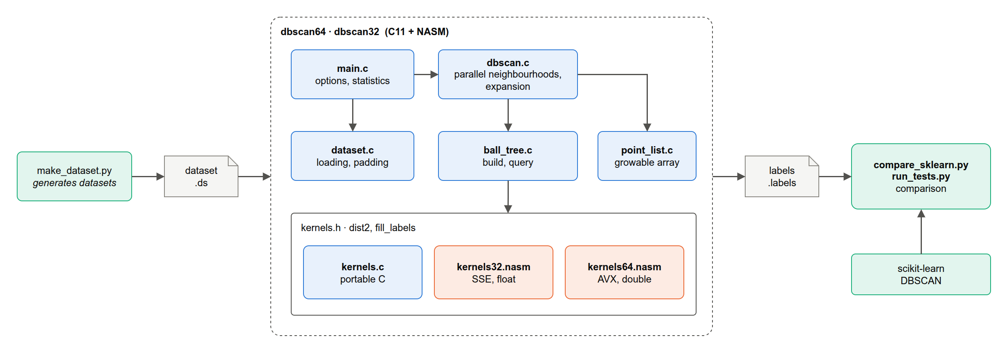

<h1 align="center">DBSCAN · SIMD · OpenMP</h1>

<p align="center">
  <strong>Density-based clustering in C and x86 assembly, accelerated with a ball tree, SSE/AVX kernels and OpenMP.</strong><br>
  16× faster than the version delivered for the exam, 2.8× faster than scikit-learn, with identical labels.
</p>

<p align="center">
  <a href="https://github.com/GabrieleHML/dbscan-simd-openmp/actions/workflows/ci.yml"></a>
  
  
  
  
</p>

This project started as the assignment for the **Computer Architecture and Programming** course
(*Architetture e Programmazione dei Sistemi di Elaborazione*, University of Calabria, academic year 2023/24),
by Gabriele Hamil and Giovanni Pascuzzi on a template provided by Prof. Fabrizio Angiulli. It was later
reworked as a portfolio project ([what changed](#from-the-exam-version-to-today)). The full report, in
Italian, is [`docs/relazione.pdf`](docs/relazione.pdf).

## What it does

[DBSCAN](https://en.wikipedia.org/wiki/DBSCAN) groups points by density. A point with at least `MinPts`
neighbours within distance `Eps` is a *core point*, and clusters grow from one core point to the next. The
algorithm needs no number of clusters, finds clusters of any shape and marks outliers as noise. Its cost is in
the neighbourhood queries: a brute-force search computes `n²` distances. This implementation attacks that cost
in three ways:

- **Compute fewer distances**: a **ball tree** skips the regions far from the query point and accepts whole
  regions that fall inside its neighbourhood.
- **Compute each distance faster**: **hand-written SIMD kernels** in NASM process 4 coordinates per
  instruction, with SSE on x86-32 (single precision) and AVX on x86-64 (double precision).
- **Compute many distances at once**: **OpenMP** spreads the queries over all the cores.

The course required four variants (32/64 bit, with and without OpenMP). They are built from one set of sources.

## Results

20,000 points in 16 dimensions (8 Gaussian clusters + 5% noise), Intel Core i5-8300H (4 cores, 8 threads),
median of 5 runs, clustering time only:

| Variant                                   | Time            | vs. exam version |
| ----------------------------------------- | --------------: | ---------------: |
| Version delivered for the exam (Jul 2024) | 2.026 s         | 1×               |
| Brute force, C                            | 3.220 s         | 0.63×            |
| Brute force, AVX                          | 1.908 s         | 1.1×             |
| Ball tree, C                              | 0.689 s         | 2.9×             |
| Ball tree, AVX                            | 0.480 s         | 4.2×             |
| Ball tree, AVX, OpenMP (4 threads)        | 0.144 s         | 14.1×            |
| **Ball tree, AVX, OpenMP (8 threads)**    | **0.127 s**     | **16.0×**        |
| scikit-learn 1.9 (`n_jobs=1` / `-1`)      | 0.358 / 0.361 s | 5.7× / 5.6×      |

- **Correctness**: the labels are identical to scikit-learn's, point by point, on every test dataset.
- **Scaling**: 3.0× speed-up on the 4 physical cores and 3.8× with Hyper-Threading (80,000 points).
- **32 vs 64 bit**: the 32-bit SSE build takes 17-37% longer. Single precision brings no gain, since both builds
  process 4 values per instruction, while cdecl passes arguments and results through memory.
- **The exam's own dataset**: the ball tree now computes 5,053 distances instead of 25 million.

The report explains every number, and `make bench` reproduces them all.

## How it works



**Two-phase DBSCAN.** In the original algorithm, the queries are interleaved with the growth of the clusters,
which leaves little to parallelise. Here the work is split in two phases:

1. The neighbourhood of every point is computed. The queries are independent, so they run in parallel
   (`#pragma omp for schedule(dynamic, 64)`), and only the neighbourhoods of core points are kept.
2. The clusters are expanded sequentially with a depth-first visit, using only the stored neighbourhoods.
   This takes under 1% of the time.

Border points reachable from two clusters go to the first one found, the same rule scikit-learn applies, so
the results can be compared exactly.

**Ball tree.** Each node is a sphere around the centroid of its points. It is split around two far-apart
points, by an in-place partition of one shared index array, so no per-node lists are allocated. The build
runs in parallel with OpenMP tasks. A query drops the nodes whose sphere is disjoint from the neighbourhood
and takes all the points of the nodes entirely inside it without computing their distances. Points are
copied in leaf order, so scanning a leaf reads contiguous memory: 20-40% faster.

**SIMD kernels.** The squared distance is computed by a NASM kernel with 4 partial sums. The loop has no
remainder, because every row is zero-padded to a multiple of 4 values and aligned to the register size (16
bytes for SSE, 32 for AVX). The kernels follow the calling conventions:

- **cdecl** on x86-32: the result is returned in `st(0)`, through a stack slot rather than a global, so
  threads can share the kernel.
- **System V** on x86-64: only caller-saved registers are used, and `vzeroupper` runs before returning.

GCC `-O2` vectorises the C version too, but it keeps the additions in their original order, one after the
other. The hand-written kernel reorders them into 4 independent sums: 1.4-1.7× faster.

## Getting started

### Prerequisites

GCC, NASM and GNU Make. The 32-bit variants also need the 32-bit C library, and the tests and benchmarks need
Python 3 with NumPy and scikit-learn.

```bash
sudo dnf install gcc make nasm glibc-devel.i686 libgcc.i686 libgomp.i686   # Fedora
sudo apt install gcc make nasm gcc-multilib                                   # Ubuntu / Debian

python3 -m venv .venv && .venv/bin/pip install -r scripts/requirements.txt
```

The 64-bit kernels need a CPU with AVX, the 32-bit ones SSE3.

### Build and run

```bash
make            # bin/dbscan64, bin/dbscan64-omp, bin/dbscan32, bin/dbscan32-omp
make x64        # only the 64-bit variants

.venv/bin/python scripts/make_dataset.py data.ds -n 20000 -d 16 --centers 8
bin/dbscan64-omp -i data.ds -e 3.9 -m 5 -o data.labels
```

```
dataset     data.ds: 20000 points, 16 dimensions
parameters  eps=3.9 min_pts=5 index=balltree leaf_size=32 simd=on threads=8 build=x86-64 AVX
clusters    8 (18070 core points, 1237 noise points)
time        0.1147 s (index 0.0106, neighbourhoods 0.1006, expansion 0.0034)
distances   66511044 computed
ball tree   2049 nodes, 1025 leaves, depth 23
labels      written to data.labels
```

```bash
.venv/bin/python scripts/compare_sklearn.py data.ds data.labels -e 3.9 -m 5
```

```
points        20000
clusters      8 (scikit-learn: 8)
noise points  1237 (scikit-learn: 1237)
mismatches    0
ARI           1.000000
```

### Tests and benchmarks

```bash
make test PYTHON=.venv/bin/python    # every variant against scikit-learn
make bench PYTHON=.venv/bin/python   # all the experiments of the report, results in results/
make report                          # rebuilds docs/relazione.pdf (LaTeX and draw.io)
```

The test suite covers datasets with clusters in 2, 13 and 64 dimensions and the exam's uniform dataset
(both as a single cluster and as pure noise). It also covers identical points, `MinPts = 1`, and datasets
smaller than a SIMD register. Each case runs with every index, kernel and thread count. The same checks run on
every push in [GitHub Actions](.github/workflows/ci.yml), for both architectures.

## Command-line options

| Option                | Description                                                        |
| --------------------- | ------------------------------------------------------------------ |
| `-i`, `--input FILE`  | dataset: `int32` columns, `int32` rows, then `float32`/`float64` values, row by row |
| `-e`, `--eps EPS`     | neighbourhood radius                                               |
| `-m`, `--min-pts N`   | points in a neighbourhood, the point itself included, to be core   |
| `-o`, `--output FILE` | labels file: `-1` is noise, clusters are numbered from `0`         |
| `--index KIND`        | `balltree` (default) or `linear` (brute force)                     |
| `--leaf-size N`       | maximum points in a ball tree leaf (default 32)                    |
| `--no-simd`           | use the C kernels instead of the SSE/AVX ones                      |
| `-t`, `--threads N`   | OpenMP threads (default: all the logical cores)                    |
| `--json`, `-q`        | print the results as one JSON line / print nothing else            |

## Project structure

```
src/           C sources: CLI, dataset loading, DBSCAN, ball tree, growable array, C kernels
  asm/         SSE (x86-32) and AVX (x86-64) kernels in NASM
scripts/       dataset generation, comparison with scikit-learn, benchmarks, report data
tests/         end-to-end tests against scikit-learn
results/       benchmark results (CSV) behind the report
docs/          report (Italian) with LaTeX sources, draw.io diagrams
```

## From the exam version to today

The version delivered for the exam is kept under the git tag
[`exam-2024`](https://github.com/GabrieleHML/dbscan-simd-openmp/tree/exam-2024), and `make exam` builds it for
comparison. Reviewing it after the course brought up real bugs:

- **OpenMP was never on.** The build scripts did not pass `-fopenmp`, so the "OpenMP" binary was
  byte-for-byte identical to the sequential one.
- **ABI violations in the assembly.**
  - x86-64: the saved registers were restored in the wrong order, corrupting `RBX`, which the caller expects
    to be preserved.
  - x86-32: the result was returned through a global variable, a data race as soon as two threads call the
    kernel.
- **A benchmark that measured nothing.** The test dataset was uniform noise with an `Eps` larger than almost
  every distance: one single cluster, so the ball tree could never prune anything. The timings used `clock()`,
  which sums the CPU time of all the threads.
- **Smaller bugs**: an out-of-bounds read when saving the labels, an off-by-one bounds check, memory leaks, and
  an infinite recursion in the ball tree on duplicate points.

The rewrite replaced four copies of the program with one source tree, added the two-phase algorithm, the
in-place ball tree and the pointer-based kernels, and added tests against scikit-learn, reproducible
benchmarks and CI. Comments and identifiers are now in English.

## Limitations and future work

- **Memory**: the neighbourhoods of the core points are kept until the expansion, like in scikit-learn. With
  an `Eps` that covers most of the dataset they take `O(n²)` memory. A union-find over core points would avoid
  that and make the expansion parallel too.
- **Kernels**: a single accumulator chains every addition to the previous one; 2-4 independent accumulators,
  FMA or AVX-512 would go further, at the cost of CPU compatibility.
- **Index**: like any spatial index, the ball tree prunes less as the dimensions grow. A k-d tree for low
  dimensions, or an automatic choice as in scikit-learn, would help.

## License

[MIT](LICENSE) © Gabriele Hamil, Giovanni Pascuzzi
